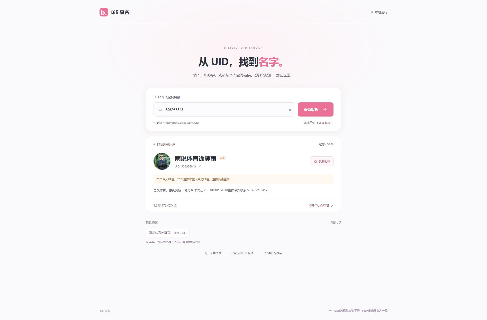

# Bili 查名

输入哔哩哔哩 UID 或个人空间链接，单个或批量查询对应昵称。本地软件，以浏览器作为界面。



## 下载

**不想安装 Python：** 到 [Releases 下载 Windows 免安装版](https://github.com/ncllw/bilibili-uid-lookup/releases/latest)，完整解压后双击 `BiliUidLookup.exe`。

**下载 Python 源码版：**

在 GitHub 仓库页面点击 **Code → Download ZIP**，解压后启动；也可使用 Git：

```powershell
git clone https://github.com/ncllw/bilibili-uid-lookup.git
cd bilibili-uid-lookup
```

## 启动

### Windows 免安装版

便携版适用于 **Windows 10/11 64 位**。将便携 ZIP 完整解压，双击其中的 **BiliUidLookup.exe**，无需安装 Python。可将解压后的整个文件夹复制到 U 盘运行；必须保留 `_internal` 文件夹。

程序会打开一个命令窗口和浏览器查询页面。关闭命令窗口即可停止服务。仍需联网访问哔哩哔哩，无需管理员权限。

便携程序没有代码签名，Windows 的应用信誉提示及杀毒软件的判断可能因电脑而异。文件夹版使用 `--onedir --noupx` 打包；这不保证不会误报。下载包的 SHA256 只用于核对完整性，不是安全认证。

### Python 源码版

双击 **start.cmd**，会启动服务并打开 `http://127.0.0.1:18763`。需要 Python 3.10 或更新版本，无需安装第三方依赖。关闭启动的命令窗口即可停止服务。

尚未安装 Python 时，可从 [Python 官网](https://www.python.org/downloads/) 安装 Python 3.10 或更新版本；Windows 安装时勾选 **Add Python to PATH**。

也可在本目录运行：

```powershell
python server.py --open
```

端口被其他软件占用时，可运行 `python server.py --port 18764 --open`。

## 使用

- **批量查询（默认）**：每行粘贴一个 UID 或个人空间链接，点击“开始批量查询”。一次最多 200 条，空行自动忽略，结果严格保留原顺序和重复项。
- 查询逐条进行并显示进度。单条失败会显示具体原因；遇到网络不可用或哔哩哔哩限制查询时暂停，保留已经得到的结果。
- 点击“停止查询”后，等待当前条完成再停止发送后续请求。“重试未成功项”可继续处理未查询或失败的行，已成功的行会保留。
- 支持“复制 UID＋昵称”（两列）、“只复制昵称”（一列）、“导出 CSV”。失败和未查询行保留占位，避免昵称与 UID 错位。CSV 使用 UTF-8 BOM，可在 Excel 中打开；公式样式的昵称和超过 15 位的数字会按文本导出。
- **单个查询**：切换到“单个查询”，输入 `306936843` 或 `https://space.bilibili.com/306936843`，点击“查询昵称”。
- 支持带查询参数、带 `/video` 等子路径的个人空间链接。
- 结果显示昵称、UID、头像和可获取的公开资料，可复制昵称或 UID，也可打开个人空间。
- 最近 8 条成功查询只保存在当前浏览器，可以一键清空。点击记录会重新查询。
- 成功响应在服务内存中缓存 5 分钟，缓存结果会明确标注。重启服务会清空缓存。
- 不要求登录、不收集 Cookie；运行时需要联网访问哔哩哔哩。接口限制访问时显示错误，不会伪造或硬编码结果。
- 服务仅监听本机 `127.0.0.1`。没有部署到公共服务器。

批量查询列表和结果只保留在当前页面，刷新或关闭页面前请复制或导出。单个查询的最近记录仍按上述方式保存在当前浏览器。

升级时请先关闭旧版本的命令窗口，再打开新版。请重新下载完整便携 ZIP，不要只替换其中的 EXE。

公开仓库提供源码下载。查询功能需要在本机运行 `server.py`，仅打开 HTML 文件或将静态文件发布到 GitHub Pages 无法直接查询。

## GitHub 调研（2026-10-17）

| 项目 | 调研结果 | 本工具的处理 |
| --- | --- | --- |
| [SocialSisterYi/bilibili-API-collect](https://github.com/SocialSisterYi/bilibili-API-collect) | 原仓库已于 2026-01-30 归档并停止维护，原文档已移除 | 不作为依赖 |
| [Nemo2011/bilibili-api](https://github.com/Nemo2011/bilibili-api) | 原仓库已于 2026-07-06 归档并停止维护 | 不引入完整 SDK |
| [pskdje/bilibili-API-collect 的用户信息文档](https://github.com/pskdje/bilibili-API-collect/blob/main/docs/user/info.md#用户名片信息) | 归档分支仍保留用户名片接口说明：以 `mid` 查询，昵称位于 `data.card.name` | 参考接口说明，以 Python 标准库独立实现，无复制项目源码 |

实际请求 `https://api.bilibili.com/x/web-interface/card?mid=306936843`，读取 `data.card.name`。首次制作时已联网验证示例返回“雨说体育徐静雨”；昵称以查询时接口返回为准，可能随用户改名而变化。接口属于哔哩哔哩站内接口，能否查询取决于当时的网络和平台响应。

## 文件

- `server.py`：输入解析、请求、缓存和本机 HTTP 服务。
- `web/`：无需构建的 HTML、CSS、JavaScript 界面。
- `start.cmd`：Windows 双击启动。
- `test_server.py`：输入校验、响应处理、缓存和 HTTP 行为测试。运行 `python -m unittest -v`。
- `web/batch.js`：批量队列、进度显示、停止/重试、复制和 CSV 导出。
- `test_batch.js`：队列顺序、重复项、失败处理、停止恢复、限流暂停和导出测试。开发验证命令为 `node --test test_batch.js`，普通使用不需要 Node.js。
- `portable.py`：便携程序入口，默认自动打开浏览器，支持 `--self-test` 和 `--no-browser`。
- `build_portable.py`：在 Windows 64 位 Python 环境中生成便携文件夹、ZIP 和 SHA256 校验文件。

## 构建便携版

```powershell
python -m pip install -r requirements-build.txt
python build_portable.py
```

产物位于 `dist/`，完整分发 `bilibili-uid-lookup-v1.2.0-windows-x64-portable.zip`。构建依赖只用于制作便携版，普通源码运行不需要安装依赖。
